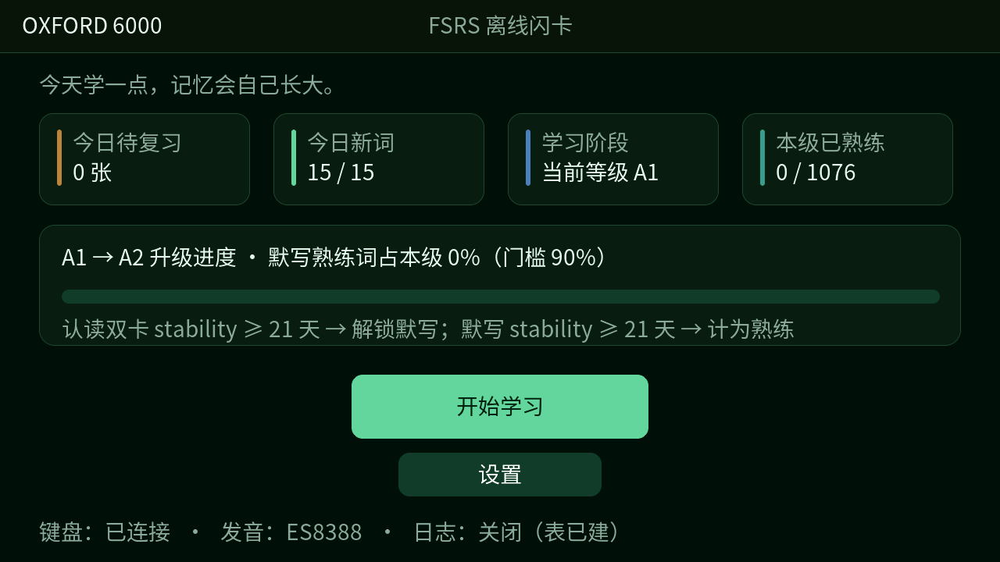
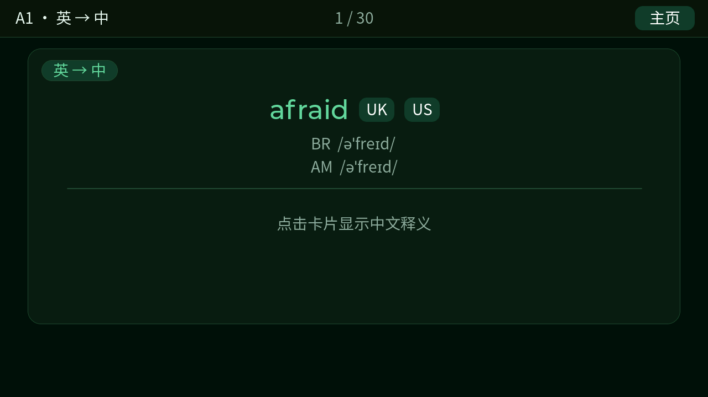
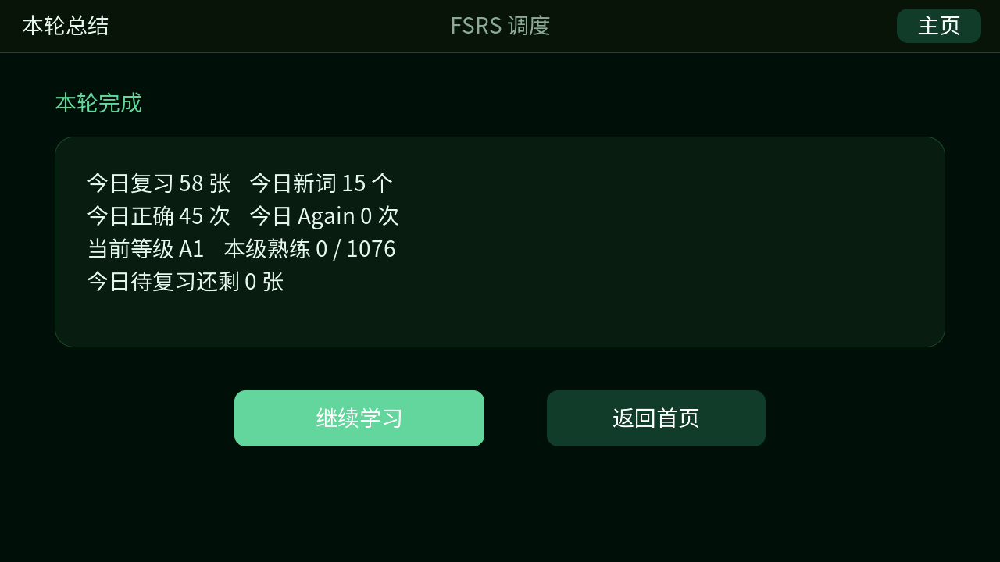

# Tab5 FSRS Vocabulary Trainer

An offline FSRS-6 vocabulary trainer for **M5Stack Tab5 (ESP32-P4)**, built
with ESP-IDF, C++, LVGL 9, SQLite, and the Tab5 Keyboard.

The app turns each vocabulary item into three independently scheduled cards:

- **English → Chinese recognition**
- **Chinese → English recall**
- **Dictation with letter-count blanks**

Recognition and recall use Again / Hard / Good / Easy. Dictation uses only
Again / Good and accepts input from the physical Tab5 Keyboard.

> This repository does not include the Oxford word database or Oxford audio
> files. Users must supply data they have the right to use. See
> [database/README.md](database/README.md) and
> [THIRD_PARTY_LICENSES.md](THIRD_PARTY_LICENSES.md).
>
> This is an independent project and is not affiliated with or endorsed by
> Oxford University Press.

## Screenshots

<p align="center">
  
  
  
</p>

The screenshots above were captured on a Tab5 with `Ctrl+S`. They intentionally
show only interface and scheduling state, not third-party definitions,
examples, or audio. See [docs/screenshots.md](docs/screenshots.md) for the
capture workflow and licensing guidance.

## Features

- FSRS-6 scheduling with fixed official default parameters and 90% desired
  retention; no cloud or on-device parameter optimization.
- Three independently scheduled cards per word.
- Stability-based progression:
  - recognition and recall must both reach a stability threshold before
    dictation is unlocked;
  - dictation must reach its threshold before the word counts as mastered;
  - the next CEFR level unlocks when the current level reaches a configurable
    mastered ratio.
- A1 → A2 → B1 → B2 → C1 monotonic progression.
- Daily new-word quota, due-review priority, learning steps, and an optional
  per-session card limit.
- SQLite progress stored in a separate database on the TF card.
- Optional review logging; the table exists from first boot but is disabled by
  default.
- UK/US MP3 pronunciation buttons next to every displayed word.
- Tab5 Keyboard character mode over I2C, including Ctrl+S screenshot capture.
- IP2326 charging enable plus live INA226 battery percentage/voltage in the top bar.
- Five-minute backlight sleep; touch or any keyboard key wakes the display.
- First-run WiFi scanning and password entry, with credentials persisted in NVS
  and an airplane-mode switch in Settings.
- 1280×720 dark green UI with a Noto Sans CJK + IPA font subset.
- ESP32-P4 v1.x compatibility; ST7121/ST7123/ILI9881C display auto-detection.
- FAT long-filename support for DB and MP3 filenames.

## Hardware

- M5Stack Tab5, ESP32-P4, 16 MB Flash / 32 MB PSRAM
- 5-inch 1280×720 IPS touch display
- ES8388 audio codec
- RX8130CE RTC
- Tab5 Keyboard over Ext.Port1
- FAT32 microSD card

The current board reports ESP32-P4 revision v1.3. The project therefore selects
the ESP-IDF v1.x compatibility path rather than the default v3.1+ build.

## Repository layout

```text
firmware/                 ESP-IDF application
  main/                   UI, database, FSRS, keyboard, audio, RTC
  components/             Tab5 BSP, ST7121 driver, vendored SQLite
  sdkconfig.defaults      Board and runtime defaults
  partitions.csv          16 MB Flash / 8 MB app partition
database/sample.db        Synthetic public sample data
docs/architecture.md      Data model and scheduling details
docs/progress_schema.sql  Progress database DDL
docs/screenshots.md       Device screenshot workflow
tools/                    Sample DB and screenshot conversion tools
```

## Build

ESP-IDF 5.5.4 is recommended.

```bash
source ~/.espressif/tools/activate_idf_v5.5.4.sh
cd firmware
idf.py set-target esp32p4
export ESP_IDF_VERSION=5.5
export IDF_COMPONENT_STORAGE_URL=https://components-file.espressif.com.cn/
export IDF_COMPONENT_CHECK_NEW_VERSION=0
idf.py build
```

The first build downloads LVGL and Espressif managed components. The patched
SQLite ESP-IDF port is vendored locally because ESP-IDF 5.5.4/GCC 14 requires a
release-mode assert adjustment for the SQLite amalgamation.

## Run

Prepare a FAT32 card:

```text
/database/oxford.db
/audio/uk_audio_split_24m/*.mp3
/audio/us_audio_split_24m/*.mp3
```

The volume label does not matter; the firmware mounts the card at `/sdcard`.
For a public demo, rename `database/sample.db` to `oxford.db`.

Flash the board:

```bash
cd dist/tab5-fsrs
./flash.sh /dev/cu.usbmodemXXXX
```

The progress database is created automatically at
`/sdcard/fsrs_progress.db`.

## FSRS progression

```text
new word
   ↓
recognition card + recall card
   ↓ both stability >= recognition threshold
dictation card unlocked
   ↓ dictation stability >= dictation threshold
word marked mastered
   ↓ enough words in the current CEFR level are mastered
next CEFR level unlocked
```

The defaults are 21 days for both stability thresholds, a 90% level-unlock
ratio, 15 new words/day, and a 60-card session limit. These values are stored
in the progress DB and can be adjusted without changing the scheduler.

## SD card write policy

WAL is intentionally disabled. It is a concurrency/atomicity feature, not a
wear-leveling mechanism, and it introduces extra `-wal` and `-shm` files.

The progress DB uses:

```sql
PRAGMA journal_mode=PERSIST;
PRAGMA synchronous=FULL;
PRAGMA temp_store=MEMORY;
```

Writes happen once per card rating, plus one aggregate `daily_stats` row per
day. `review_log` rows are only written when the setting is enabled.

## Data licensing

The source code is separate from the vocabulary dataset. Do not publish
third-party definitions, examples, or recordings unless their license allows
redistribution. The public sample database is synthetic. The included
screenshots contain no Oxford definition or example text.

## Contributing

See [CONTRIBUTING.md](CONTRIBUTING.md) and the
[GitHub publishing checklist](docs/open-source.md). Hardware reports should
include:

- Tab5 display/touch revision
- ESP32-P4 chip revision
- serial boot log
- whether other-keyboard data or audio files were used

## Acknowledgements

- M5Stack for the Tab5 BSP and hardware documentation
- LVGL and Espressif for the graphics stack
- SQLite and the ESP-IDF SQLite port
- Open Spaced Repetition for FSRS
- Noto Fonts for the OFL-licensed CJK and IPA glyphs

